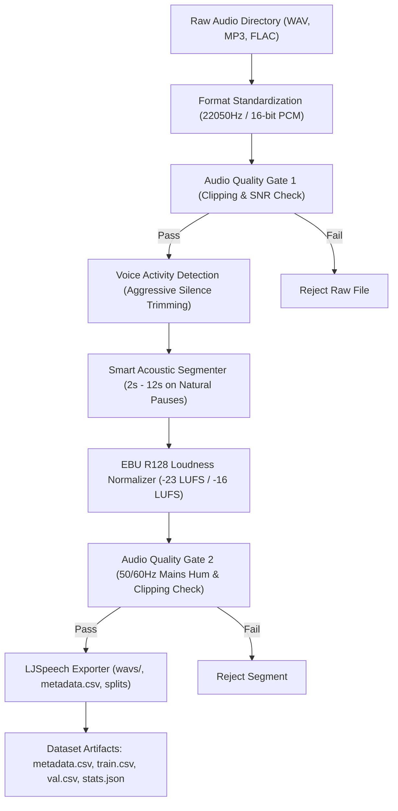

[🇸🇦 العربية](README.ar.md) | [🇬🇧 English](README.md)

# 🎙️ eidcloud-voice-dataset

Automated Voice Dataset Factory for Speech AI with VAD silence trimming, loudness normalization, and LJSpeech metadata generation.

[](https://github.com/shadi-alhasan/eidcloud-voice-dataset/releases)
[](https://php.net)
[](LICENSE)
[](https://colab.research.google.com/github/shadi-alhasan/eidcloud-voice-dataset/blob/main/notebooks/quickstart.ipynb)

`eidcloud-voice-dataset` provides a high-throughput, enterprise-grade pipeline designed for Speech AI, Text-to-Speech (TTS: XTTS, Bark, FastSpeech, VITS), and Automatic Speech Recognition (ASR: Whisper) dataset preparation. It features Voice Activity Detection (VAD), EBU R128 loudness normalization, smart acoustic segmentation, and strict quality gates with pure PHP 8.2+ fallbacks.

---

## ⚡ Architecture Flow



---

## 🚀 Key Capabilities

- **Voice Activity Detection & Silence Trimming**: Strips dead silence and non-speech margins using dual-pass FFmpeg `silenceremove` with pure PHP RMS frame window fallback.
- **EBU R128 Loudness Normalization**: Calibrates target loudness to standard `-23.0 LUFS` (broadcast/speech standard) or `-16.0 LUFS` (podcast standard) with true-peak limiter protection.
- **Smart Acoustic Segmentation**: Automatically detects natural conversational pauses and segments long recordings into clean cuts between `2.0s` and `12.0s` — optimal for TTS models.
- **Strict Audio Quality Gates**:
  - SNR thresholding (filters noisy recordings).
  - Digital clipping and saturation detection.
  - Goertzel-based 50Hz / 60Hz mains hum detection.
- **LJSpeech 1.1 Specification**: Emits `wavs/`, `metadata.csv` (`ID|RawText|NormalizedText`), deterministic `train.csv` / `val.csv` splits, and `stats.json`.
- **Zero-Dependency Core**: Full fallback engine in pure PHP 8.2+ with automatic CLI detection for FFmpeg acceleration.

---

## 📦 Installation

```bash
git clone https://github.com/shadi-alhasan/eidcloud-voice-dataset.git
cd eidcloud-voice-dataset
composer install # Optional: repo includes standalone PSR-4 autoloader
```

### System Requirements
- PHP 8.2 or higher
- Optional: `ffmpeg` (recommended for accelerated multi-pass audio processing)

---

## 💻 CLI Usage

### Build a Voice Dataset
Transform a folder of raw speech recordings into an LJSpeech-ready training set:

```bash
# Standard build
php bin/eidcloud-voice build ./raw_audio/ --output=./dataset/

# Custom loudness target (-16 LUFS podcast) and segment duration constraints
php bin/eidcloud-voice build ./raw_audio/ --output=./dataset/ --lufs=-16.0 --min-sec=2.0 --max-sec=10.0

# Automated ML pipeline output (structured JSON)
php bin/eidcloud-voice build ./raw_audio/ --output=./dataset/ --json
```

### Audit an Existing Dataset
Verify audio fidelity, format compliance, and clipping:

```bash
# Standard audit
php bin/eidcloud-voice audit ./dataset/

# Strict audit (fails on warnings or sub-threshold SNR)
php bin/eidcloud-voice audit ./dataset/ --strict
```

### CLI Options

| Flag | Default | Description |
|---|---|---|
| `--output=<dir>` | `./dataset/` | Destination directory for processed files |
| `--transcripts=<file>` | `None` | JSON file mapping filename to transcription text |
| `--lufs=<float>` | `-23.0` | Target integrated loudness in LUFS |
| `--min-sec=<float>` | `2.0` | Minimum segment length in seconds |
| `--max-sec=<float>` | `12.0` | Maximum segment length in seconds |
| `--min-snr=<float>` | `15.0` | Minimum Signal-to-Noise Ratio in dB |
| `--train-ratio=<float>` | `0.90` | Training vs validation split ratio |
| `--strict` | `false` | Enable strict quality verification in audit |
| `--json` | `false` | Machine-readable JSON output for CI/CD |

---

## 🧩 Programmatic PHP API

```php
<?php

use EidCloud\VoiceDataset\DatasetFactory;

require_once __DIR__ . '/autoload.php';

$factory = new DatasetFactory([
    'target_lufs' => -23.0,
    'min_segment_sec' => 2.0,
    'max_segment_sec' => 10.0,
    'min_snr_db' => 15.0,
    'train_ratio' => 0.90,
]);

// Build dataset
$result = $factory->build(
    rawAudioDir: './raw_audio/',
    outputDir: './dataset/',
    transcripts: [
        'speaker1_take1' => 'The quick brown fox jumps over the lazy dog.'
    ]
);

echo "Created " . $result['accepted'] . " compliant segments.\n";

// Audit dataset
$audit = $factory->audit('./dataset/', strict: true);
if ($audit['passed']) {
    echo "Dataset is fully compliant with Speech AI standards!\n";
}
```

---

## 🧪 Testing

Run the zero-dependency test suite:

```bash
php tests/run_tests.php
```

---

## 👤 Author & Maintainer

**Eng. MHD. Shadi AL-Hasan**  
- **Role:** Executive CTO & Enterprise Solutions Architect  
- **Email:** [mhd.shadi.alhasan@gmail.com](mailto:mhd.shadi.alhasan@gmail.com)  
- **Phone / WhatsApp:** [+963934005922](tel:+963934005922)  
- **Location:** Damascus, Syria  
- **GitHub:** [shadialhasan](https://github.com/shadialhasan)  

---

## 📄 License

This project is licensed under the MIT License - see the [LICENSE](LICENSE) file for details.  
Copyright (c) 2026 **MHD. Shadi AL-Hasan**. All rights reserved.
